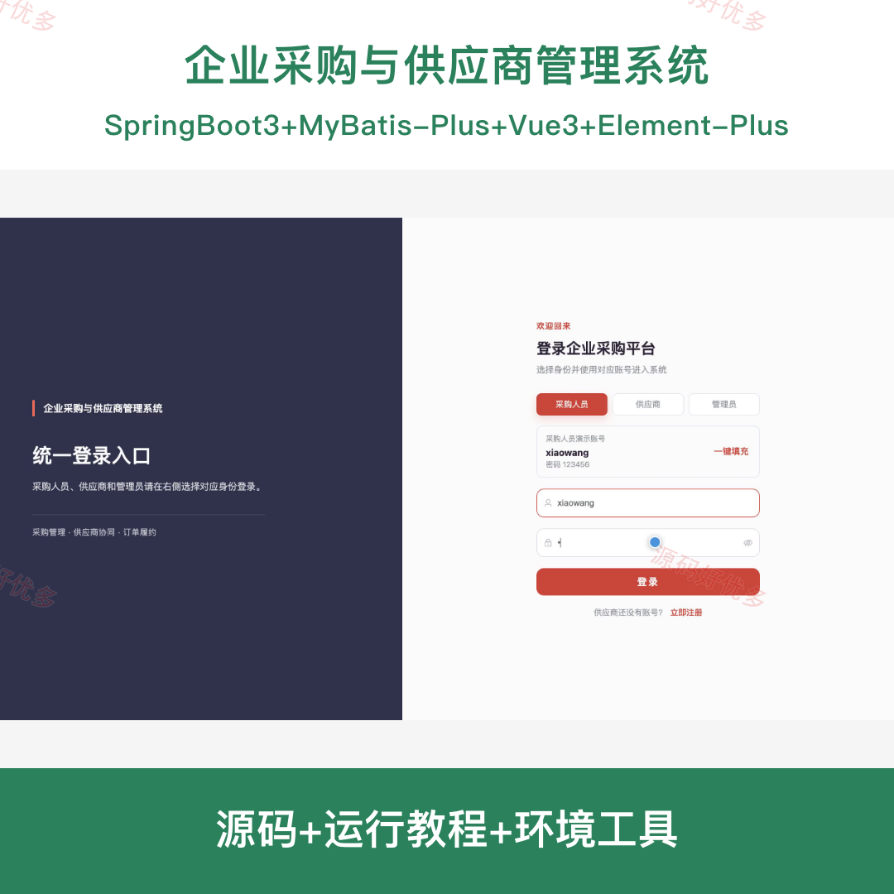
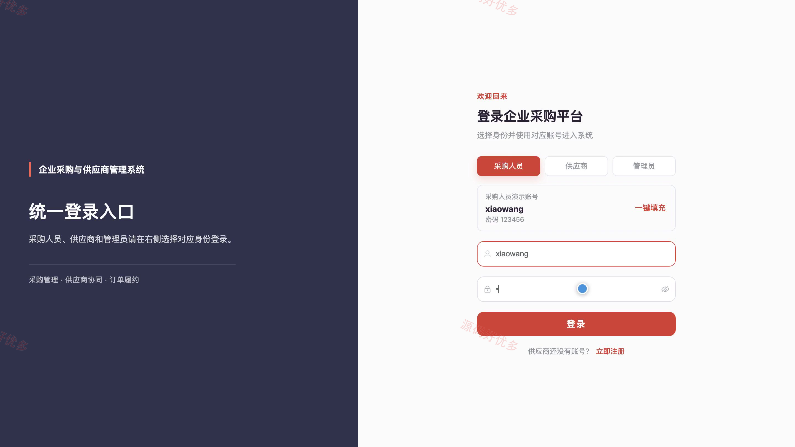
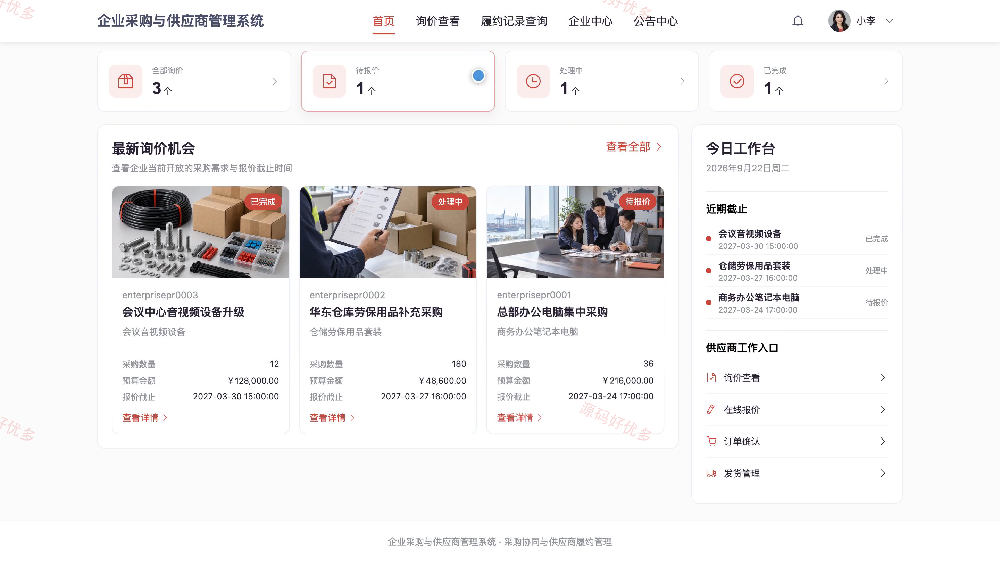
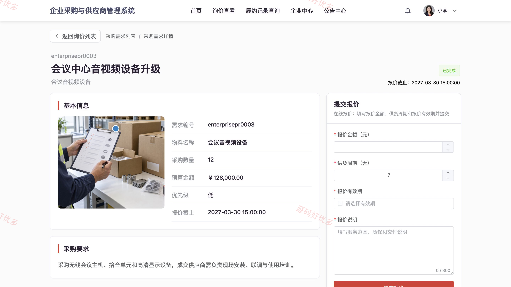
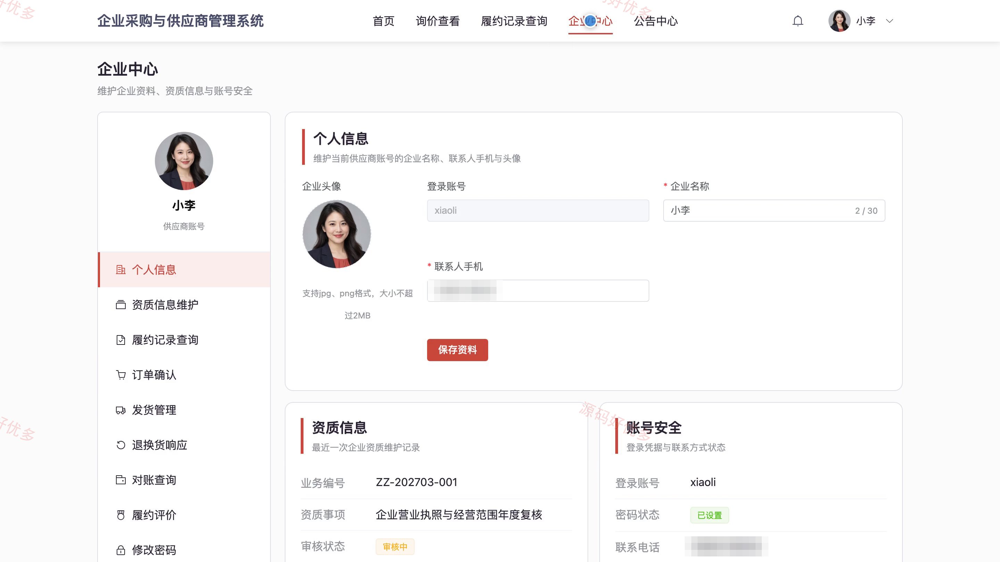
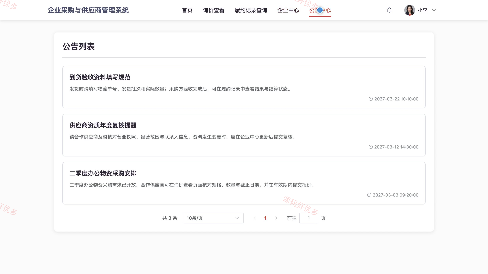
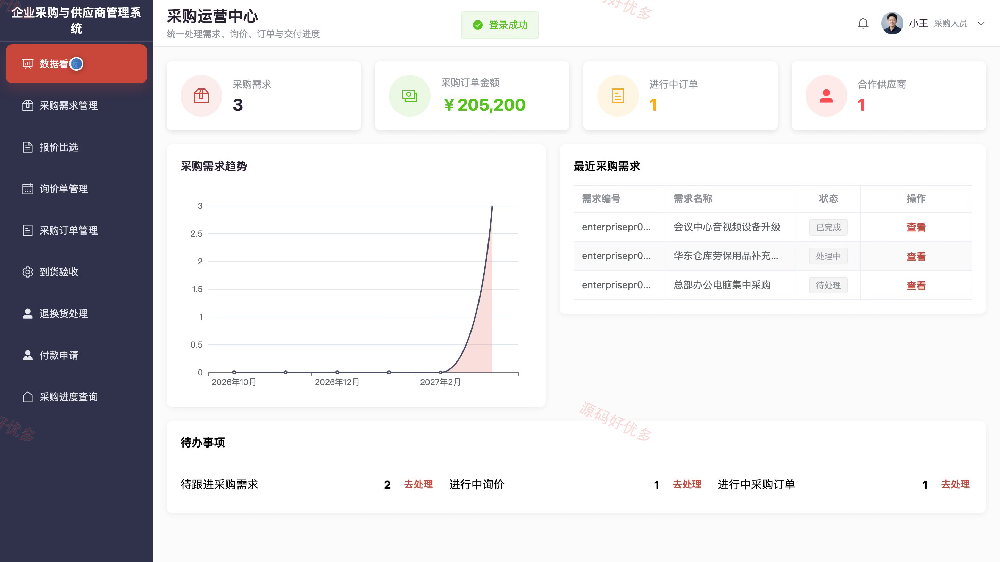
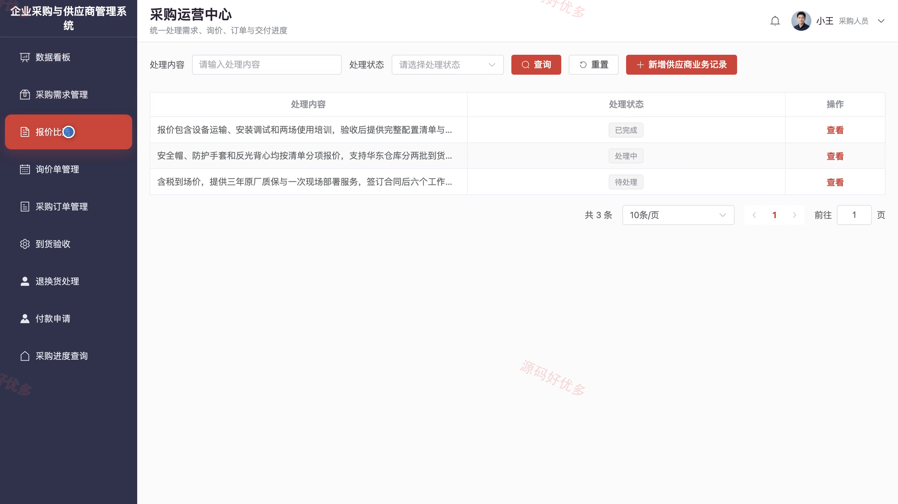
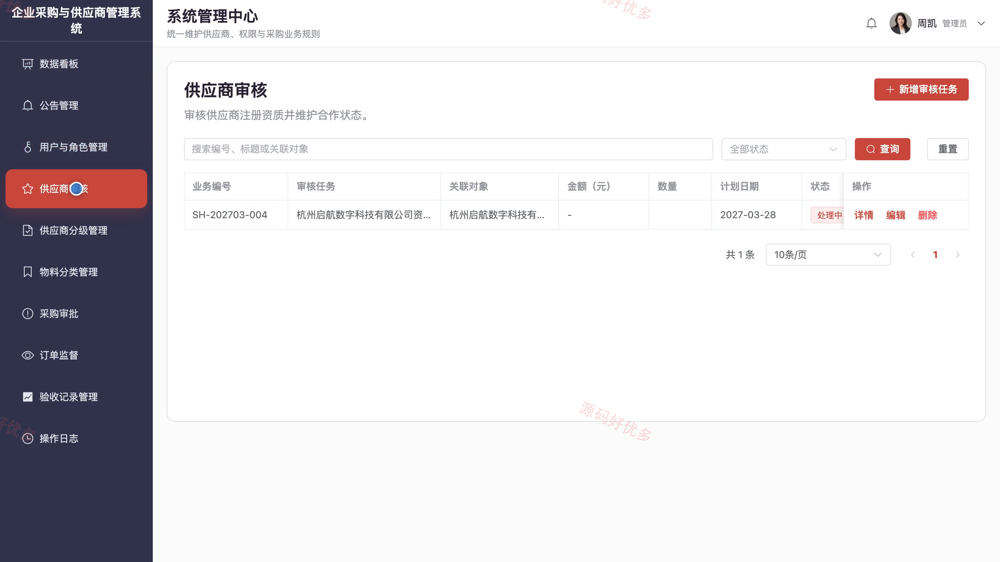

## 源码问题查看主页咨询

### 一、关键词
企业采购、供应商协同、采购询价、订单履约、采购审批

### 二、作品包含
源码+数据库+全套环境和工具资源+本地部署教程

### 三、项目技术
前端技术： Html、Css、Js、Vue3.4、Element-Plus
后端技术：Java、SpringBoot3.2.0、MyBatis-Plus

### 四、运行环境要求
开发工具：IDEA/eclipse + VSCODE

数据库：MySQL5.7+（共7张表）

数据库管理工具：Navicat10以上版本

环境配置软件： JDK17 + Maven3.6

前端Nodejs：16+

浏览器：谷歌浏览器

### 五、项目介绍
项目编号：bs131A

本系统面向企业采购人员、供应商和管理员，覆盖采购需求、询价报价、订单履约、到货验收与付款申请等业务。供应商可在线报价并跟进发货和结算；管理员负责供应商审核、采购审批与业务统计。

角色：采购人员、供应商、管理员

采购人员功能：登记和查询采购需求、向供应商发起询价、比较报价与交期、生成和维护采购订单、记录到货验收结果、处理退换货事项、提交采购付款申请、查询采购进度并维护个人资料。

供应商功能：注册登录并维护企业资质、查看有效询价单、提交在线报价、确认采购订单、登记发货批次与物流信息、响应退换货要求、查询对账与结算记录、查看履约记录并维护联系人资料。

管理员功能：管理用户账号与角色权限、审核供应商资质与合作状态、维护供应商等级、维护物料分类、审核采购需求与付款申请、监督订单和验收异常、发布采购公告、查看操作日志与采购统计。

### 六、运行截图

